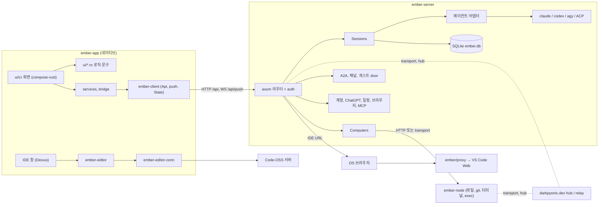

# Ember (darkpyonix-ember) 코드베이스 개요

- 분석 기준 커밋: `ffe98256a35046158c3baae2065611168b70d97f` (develop) / 분석일: 2026-11-12 ~ 2026-11-13
- 규모: 파일 844개 / 약 281,800줄 (Rust 82.4%, Markdown 3.6%, HTML 2.3%, Python 1.8%, TypeScript 1.7%, CSS 1.6%, JavaScript 1.4%, Kotlin 1.4%, 기타). Rust 중 약 4만 6천 줄이 `tests/`.
- 검증: 문서 안 `경로:줄` 참조 1,974개 중 무작위 표본 2회(196개, 197개). 표본마다 참조 옆 이름이 코드의 그 줄 ±3줄 안에 있는지 확인했다. 확인 가능한 296개 중 실제로 틀린 것은 1개(축약 경로, 고침)로 오류율 약 0.3%. 자동 검사가 놓친 12개는 사람이 보니 모두 맞았다. 이름 사전의 이름 254개는 모두 코드에 있다. 문서 간 링크 깨짐 0, 비밀값 노출 0, em-dash 0. 남은 표시: `[확인 필요]` 72개, `[추정]` 20개. 검증 스크립트는 `.scratch/analysis/verify.py`.
- 이 문서 세트는 코드를 고치지 않고 읽기만 해서 만들었다. 빌드와 테스트는 돌리지 않았다.

## 한 문단 요약

Ember는 여러 AI 코딩 에이전트 CLI(Claude Code, Codex, Antigravity, ACP 에이전트)를 감싸서 한 곳에서 쓰게 하는 개발 환경이다. **메인 서버**(`ember-server`)가 에이전트 프로세스를 띄우고 대화(세션)와 이벤트를 SQLite에 저장하며, 변경을 push로 클라이언트에 보낸다. **네이티브 앱**(`ember-app`, 웹뷰 없는 compose-rust UI)이 프로젝트, 세션, 채널, 루틴, 버전 관리, 에이전트, 파일 화면을 그린다. 도구 실행은 사용자의 여러 컴퓨터에서 도는 **노드 데몬**(`ember-node`)으로 보낼 수 있고, 서버와 노드는 HTTP나 P2P 전송(`ember-transport`, darkpyonix.dev 허브)으로 이어진다. IDE는 VS Code Web을 감싸는 `ember/proxy/`(Python)로 브라우저에서 열거나, Code-OSS 서버에 직접 붙는 네이티브 에디터 창(`ember-editor`)으로 연다. 노트북용 VS Code, IntelliJ 확장도 같은 저장소에 있다.

## 기술 스택

| 영역 | 사용 기술 |
|---|---|
| 서버 | Rust, tokio, axum 0.8, rusqlite(SQLite bundled), chacha20poly1305, croner, 선택 NFS/FUSE |
| 노드 | Rust, axum, portable-pty, alacritty_terminal, ignore/grep, sysinfo, `git`/`gh` 실행 |
| 앱 | Rust 2024, compose-rust(기본 화면), dioxus-compose(별도 IDE 창, 옛 화면), ember-client |
| 네트워크 | 자체 `ember-transport` (letify-link, 선택 iroh), darkpyonix.dev 허브 |
| 에디터 | `ember-editor-conn`(VS Code 원격 프로토콜), `ember-editor`(Oniguruma TextMate 해석기) |
| proxy | Python 3.10+, FastAPI, uvicorn, httpx, websockets 12.0(고정), 정적 JS 오버레이, 동반 VS Code 확장(JS) |
| 확장 | TypeScript(VS Code), Kotlin/Gradle(IntelliJ), JSON 테마 |
| CI | GitHub Actions: 크레이트별 `cargo test`, 저장소 규칙 검사 스크립트, OSE 빌드, 확장 빌드 |

상세: [_raw/stack.md](_raw/stack.md).

## 실행 방법

| 목적 | 명령 |
|---|---|
| 메인 서버 | `cd ember/server && cargo build --release --locked && ./target/release/ember-server` (기본 `127.0.0.1:8740`, 토큰은 `~/.ember/server-token`) |
| 앱 | `cd ember/app && EMBER_SERVER_URL=http://127.0.0.1:8740 cargo run --release --locked` |
| 앱 (서버 없이 데모) | `EMBER_DEMO_DATA=1`, `EMBER_SERVER_URL` 없이 실행 |
| 노드 | `EMBER_NODE_TOKEN=<토큰> ember-node` (기본 `127.0.0.1:8741`) |
| proxy | `cd ember/proxy && uv run --with-requirements requirements.txt uvicorn main:app --port 8888` |
| 테스트 | 크레이트마다 `cd ember/<crate> && cargo test --locked`; proxy `python3 -m unittest`; VS Code 확장 `npm test` |
| 타입 체크·린트 | `cargo check --locked`, `cargo clippy`; 확장 `npm run typecheck`; 저장소 규칙 `bash .github/scripts/checks/*.sh` |

저장소 규칙: 빌드는 한 번에 하나, `CARGO_BUILD_JOBS=2` (`AGENTS.md`). 환경 변수 전체는 [02_GLOSSARY-2.md](02_GLOSSARY-2.md#환경-변수), 서버 옵션은 `ember/server/src/main.rs:24-77`의 주석이 가장 정확하다.

## 전체 구조

## 모듈 안내

| 모듈 | 책임 | 규모 | 문서 |
|---|---|---|---|
| `transport` | Ember의 모든 네트워크 접근을 하나의 P2P 인터페이스(`Transport`, `Connection`, `BiStream`)로 감싸고, 백엔드(letify-link, 선택 iroh, 인메모리 가짜)와 기기 입장 제어(`PeerGate`), ... | 파일 16 / 5,516줄 | [modules/transport.md](modules/transport.md) |
| `transfer` | 사용자 장치 사이 파일 전송의 제안(offer), 수락, 거절, 취소 핸드셰이크, 이름 정리, 크기 제한, 수신 모드, 청크 저장과 SHA-256 검증을 맡는다 (`ember/transfer/src/lib.rs:1`, SPEC `FR-F1`..`FR-F10`). | 파일 9 / 2,196줄 | [modules/transfer.md](modules/transfer.md) |
| `bridge` | VS Code Web 웹뷰(`detach.js`)와 네이티브 셸이 주고받는 창 분리 메시지의 형식, 인코딩, 처리 로직을 정의한다 (`ember/bridge/src/lib.rs:1-14`, SPEC FR-B1~B4). | 파일 40 / 1,532줄 | [modules/bridge.md](modules/bridge.md) |
| `hub` | 허브 계정에 장치를 등록(device link)하고, 장치 목록, 주소, `/me`를 호출하고, 등록 파일을 보관하며, 허브가 장치를 제거했는지 감시한다 (`ember/hub/src/lib.rs:1-26`, SPEC `FR-N2`). | 파일 11 / 2,905줄 | [modules/hub.md](modules/hub.md) |
| `editor-conn` | 수정하지 않은 Code-OSS(VS Code) 서버와 공식 Node 확장 호스트에 Rust로 붙는 연결 계층. HTTP 업그레이드와 핸드셰이크, 13바이트 프레이밍, `PersistentProtocol`(ack, replay), 관리 연결 IPC, 원격 ... | 파일 18 / 5,686줄 | [modules/editor-conn.md](modules/editor-conn.md) |
| `editor` | [editor-conn](modules/editor-conn.md)이 제공하는 Code-OSS 연결 위에서 열린 문서, 확장 호스트 RPC, 진단, CodeLens, hover, 인라인 완성, 검색과 바꾸기, 구문 강조를 하나의 순수 상태 기계로 돌리고, ... | 파일 31 / 10,622줄 | [modules/editor.md](modules/editor.md) |
| `client` | UI 아래의 네이티브 클라이언트 코어. 메인 서버 `/api`를 부르는 HTTP 클라이언트(`Api`), push WebSocket 동기화 엔진(`Client`), 순수 리듀서(`State`, `Transcript`), 서버 토큰 탐색, 콜드 스타트 캐시를 ... | 파일 11 / 6,961줄 | [modules/client.md](modules/client.md) |
| `node` | 각 컴퓨터에서 도는 실행 데몬으로, 서버가 시킨 파일 조작, 명령 실행, 백그라운드 잡, 터미널, git, 브라우저 SOCKS5 출구를 토큰 인증과 경로 정책 뒤에서 수행한다. 에이전트 CLI는 돌리지 않고 대화 기록도 저장하지 않는다 ... | 파일 20 / 7,080줄 | [modules/node.md](modules/node.md) |
| `node-git` | 노드 HTTP API의 `/git/*` 요청을 받아 그 컴퓨터의 `git`, `gh` CLI를 안전하게(프롬프트 없음, 시간 제한, 출력 상한) 실행하고 결과를 JSON DTO로 바꾼다. | 파일 9 / 2,958줄 | [modules/node-git.md](modules/node-git.md) |
| `node-term` | 노드 데몬이 소유하는 영속 터미널 세션(SPEC §P, FR-P1-P6)을 만들고, 여러 클라이언트가 붙고 떨어지게 하며, 화면을 터미널 모델로 유지해 재접속 시 그대로 복원한다. `ember-term`은 VS Code 터미널 같은 로컬 터미널을 그 세션에 이어 ... | 파일 6 / 2,708줄 | [modules/node-term.md](modules/node-term.md) |
| `node-enrol` | `ember-node enrol <code> --server <url>`로 서버의 enrol 문에서 일회용 코드를 교환하고, 소유자 승인을 기다려 서버가 발급한 노드 토큰을 `<state dir>/enrol.json`에 안전하게(원자적, 0600, 잠금) ... | 파일 2 / 2,966줄 | [modules/node-enrol.md](modules/node-enrol.md) |
| `server-core` | 세션을 만들고 에이전트 프로세스를 띄우고(또는 shim에 다시 붙고), 모든 이벤트를 SQLite에 먼저 저장한 뒤 클라이언트에 푸시하며, 로컬 리스너를 토큰과 Host/Origin 검사로 지킨다. | 파일 16 / 5,871줄 | [modules/server-core.md](modules/server-core.md) |
| `server-agents` | 수정하지 않은 에이전트 CLI(Claude Code, Codex, Antigravity, ACP 에이전트)를 각자의 비대화형 프로토콜로 띄우고, 출력을 정규화된 `AgentEvent`로 바꾸며, 승인과 질문 답을 CLI로 돌려보낸다. | 파일 10 / 9,178줄 | [modules/server-agents.md](modules/server-agents.md) |
| `server-computers` | 서버가 부릴 수 있는 원격 컴퓨터(ember-node)를 등록하고, 세션을 컴퓨터 사이에서 옮기며(FR-X3), 에이전트의 도구(Bash, 파일, 네트워크)를 현재 컴퓨터로 보낸다. 덧붙여 transport 허용 목록(devices), darkpyonix.dev ... | 파일 26 / 8,751줄 | [modules/server-computers.md](modules/server-computers.md) |
| `server-enrol` | 다른 컴퓨터를 등록하는 일회용 enrol 코드의 발급(mint), 교환(redeem), 소유자 확인(confirm/deny), 자격 증명 1회 전달과, 그 요청을 받는 별도 리스너(enrol door)의 방어 계층을 제공한다. | 파일 7 / 4,704줄 | [modules/server-enrol.md](modules/server-enrol.md) |
| `server-collab` | 에이전트 세션 사이 메시징(A2A), 팀, 터미널 도구, 채널(그룹 대화, 피드, 초대, 게스트, 허용), 게스트 문(별도 리스너), 팀원 정의(하네스, 계정, 모델 프록시)를 담당한다. | 파일 22 / 10,631줄 | [modules/server-collab.md](modules/server-collab.md) (+ [-2](modules/server-collab-2.md)) |
| `server-api` | 네이티브 앱이 쓰는 세션·프로젝트 HTTP 라우트와 push WebSocket, "Open IDE" 대상과 OSE(VS Code 서버) 프로세스·릴레이, 프로젝트별 원격 Chrome(CDP)과 그 egress, 에이전트 세션에 주입되는 중앙 MCP 서버 ... | 파일 18 / 6,103줄 | [modules/server-api.md](modules/server-api.md) |
| `server-accounts` | 에이전트별 다중 계정과 라우팅, API 키와 ChatGPT 토큰의 암호화 저장, Sign in with ChatGPT(OAuth), 예약 작업(스케줄러), 파일 전송 서버 매니저, 토큰 사용량 집계를 맡는다. | 파일 17 / 6,665줄 | [modules/server-accounts.md](modules/server-accounts.md) |
| `app-core` | 창이 열리기 전에 tokio 런타임, `ember_client::Client`, 추가 서버 API, 메시지 outbox를 만들어 `Services` 전역으로 두고, 클라이언트 변경을 UI 신호로 바꾼다. | 파일 35 / 13,315줄 | [modules/app-core.md](modules/app-core.md) |
| `app-ui-cr` | 기본 실행 때 뜨는 compose-rust 셸(사이드바, 레일, 하단 탭)과 그 안의 홈, 채널, 검색, 새 세션, 설정 화면, 시트(컴퓨터 추가, 모니터, 멤버/게스트, 새 채널), 공용 컴포넌트와 디자인 토큰을 그린다. | 파일 21 / 12,113줄 | [modules/app-ui-cr.md](modules/app-ui-cr.md) |
| `app-ui-cr-session` | 프로젝트 화면(컴퓨터 띠, 프로젝트 상자, 프로젝트 상세, 설정 시트), 대화 화면(대화 기록, 입력창, 승인과 질문 카드, 팀 패널), 세션 화면(좌측 목록, 멀티/싱글/상태 3개 뷰, 새 팀원 시트, IDE와 웹 페이지 메뉴). | 파일 3 / 9,282줄 | [modules/app-ui-cr-session.md](modules/app-ui-cr-session.md) |
| `app-ui-cr-work` | 파일, 루틴(서버 `schedules`), 에이전트(CLI 감지, 계정, 하네스 설정), 버전 관리(노드 `/git/*`) 화면을 그리고 사용자 동작을 서버와 노드 호출로 잇는다. | 파일 4 / 15,191줄 | [modules/app-ui-cr-work.md](modules/app-ui-cr-work.md) |
| `app-ui` | Dioxus 시절 기본 화면들. 지금은 화면 컴포넌트보다 `cr/` 화면이 가져다 쓰는 상태 모델, 문구 상수, 순수 함수의 저장소 역할이 크다. | 파일 20 / 14,726줄 | [modules/app-ui.md](modules/app-ui.md) |
| `app-ui-collab` | 에이전트·채널·캐릭터·루틴 화면의 Dioxus 원본. 대응하는 `cr/` 화면이 로직 대부분을 여기서 가져다 쓴다. | 파일 5 / 7,467줄 | [modules/app-ui-collab.md](modules/app-ui-collab.md) |
| `app-ui-dev` | 파일·버전 관리 화면의 Dioxus 원본, 그리고 지금도 Dioxus로 도는 별도 IDE 창(`--editor`, `ember/app/src/lib.rs:117-136`)의 화면. | 파일 9 / 15,564줄 | [modules/app-ui-dev.md](modules/app-ui-dev.md) |
| `proxy` | 순정 VS Code Web(`code serve-web` 또는 OSE 서버)을 감싸서 로그인 게이트, 모바일 오버레이 주입, 홈 런처(에이전트 대화 열람), ember node 영속 터미널 중계(`/__terms/*`), 탭 분리(detach) 웹뷰 측을 제공한다. | 파일 51 / 10,151줄 | [modules/proxy.md](modules/proxy.md) |
| `extensions` | DarkPyonix 노트북 파일(`.pynb`, `# %%` 셀이 있는 `.py`)을 VS Code와 IntelliJ/PyCharm에서 열고, darkpyonix-core의 커널 매니저 HTTP API로 셀 실행과 다중 클라이언트 공동 편집을 하며, Ember ... | 파일 81 / 11,617줄 | [modules/extensions.md](modules/extensions.md) |
| `tooling` | CI 워크플로, 저장소 규칙 검사 스크립트, Code-OSS(OSE) 빌드 파이프라인. | 파일 44 / 2,683줄 | [modules/tooling.md](modules/tooling.md) |
| `docs` | 프로젝트의 범위, 결정, 요구사항, 설계, 사용자 안내서. 코드가 아니라서 읽는 사람용 지도로만 정리한다. | 파일 55 / 15,062줄 | [modules/docs.md](modules/docs.md) |
| `tests` | 크레이트별 통합 테스트. 테스트 이름은 대개 SPEC ID로 시작한다 (예: `fr_l31_1_...`는 FR-L31). | 파일 227 / 51,579줄 | [modules/tests.md](modules/tests.md) (+ [-2](modules/tests-2.md)) |

모듈 경계와 파일 목록: [_raw/modules.md](_raw/modules.md). 진입점과 초기화 순서: [_raw/entrypoints.md](_raw/entrypoints.md). HTTP 라우트 전체: [_raw/routes.md](_raw/routes.md).

## 상황별로 볼 문서

| 이럴 때 | 이 문서 |
|---|---|
| 사용자 피드백을 받아 고칠 곳을 찾을 때 | [01_FEATURE_MAP.md](01_FEATURE_MAP.md) → [06_FIX_GUIDE.md](06_FIX_GUIDE.md) |
| 코드에서 모르는 이름을 만났을 때 | [02_GLOSSARY.md](02_GLOSSARY.md), 환경 변수·상태값은 [02_GLOSSARY-2.md](02_GLOSSARY-2.md) |
| 기능이 실제로 어떻게 동작하는지 알고 싶을 때 | [03_FLOWS.md](03_FLOWS.md) |
| 데이터 구조나 DB를 바꿀 때 | [04_DATA_MODEL.md](04_DATA_MODEL.md) |
| 코드 정리·리팩터링을 계획할 때 | [05_ISSUES.md](05_ISSUES.md) |
| 어떤 테스트를 돌려야 하는지 알고 싶을 때 | [modules/tests.md](modules/tests.md), SPEC ID 역색인 [modules/tests-2.md](modules/tests-2.md) |
| 요구사항 ID(FR-*, D*)의 뜻을 알고 싶을 때 | `docs/SPEC.md`, `docs/INTENT.md` ([modules/docs.md](modules/docs.md)) |

## 가장 먼저 알아야 할 것 5가지

1. **앱 화면은 `ember/app/src/ui/cr/`에 있고, 로직은 같은 이름의 `ember/app/src/ui/<파일>.rs`에 있다.** 기본 실행은 compose-rust 셸 `ui::cr::shell::launch`다 (`ember/app/src/lib.rs:143-145`). `ui/`는 옮기는 중인 옛 Dioxus 화면이지만, pub 항목 약 75%를 `cr/` 화면이 그대로 쓴다. `ui/` 함수를 고치면 살아 있는 화면이 바뀐다. 통째로 안 쓰이는 것은 `ui/mod.rs`(옛 루트)와 `ui/workbench.rs`뿐이다.
2. **대화와 에이전트는 늘 메인 서버에 있다.** 컴퓨터를 바꾸면 "도구가 도는 곳"만 바뀐다 (README E3, [03_FLOWS.md](03_FLOWS.md) 흐름 4). 세션 상태는 `Store::append` 한 곳에서만 바뀐다 (`ember/server/src/store.rs:344-371`).
3. **서버에는 리스너가 셋이고 경계가 다르다.** owner 리스너(토큰과 Origin/Host 검사, 로컬 전용 라우트 포함), P2P transport(같은 `app`, 로컬 전용 라우트 없음), guest door와 enrol door(별도 리스너, 각자의 라우트만). 라우트를 어느 라우터에 붙이는지가 곧 보안 결정이다 (`ember/server/src/main.rs:443-518`).
4. **같은 값이 여러 곳에 정의돼 있다.** 앱 테마 토큰(`ui/theme.rs`와 `ui/cr/theme.rs`), 클라이언트 DTO(서버 타입의 손 복사본, `ember/client/src/wire.rs`), 채널 메시지 한도(세 곳), `"local"` 컴퓨터 id(세 곳) 등. [06_FIX_GUIDE.md](06_FIX_GUIDE.md) "함께 고쳐야 하는 곳"을 먼저 본다.
5. **저장소 규칙이 강하다.** 동작을 바꾸기 전에 `docs/SPEC.md`에 ID와 실패하는 테스트가 먼저 있어야 하고, 문서와 코드에 em-dash를 쓰면 CI가 막으며, 런처·대화 UI에 웹뷰를 넣으면 안 된다 (`AGENTS.md`).

## 우선 처리 권장 이슈

[05_ISSUES.md](05_ISSUES.md)의 심각도 "높음" 전부와 "중간" 중 영향이 큰 것.

| 이슈 | 심각도 | 내용 |
|---|---|---|
| 팀원 프록시 키로 서버 환경 변수 유출 | 높음 | 에이전트가 보낼 수 있는 `team spawn` 요청의 `proxy.key_env`로 서버 환경 변수 아무거나 읽어 임의 endpoint로 보낼 수 있다 (`ember/server/src/members.rs:209`, `ember/server/src/a2a/team.rs:252-254`). 영향 범위는 [확인 필요] |
| Windows 비밀 키 권한 | 높음 | Windows에서 `secret.key`와 계정 폴더 권한 검사가 없다 (`ember/server/src/accounts/secrets.rs:158-161`, `accounts/mod.rs:705-716`) |
| 대화 화면 기능 닿지 않음 | 높음 | 고정, 내보내기, 포크, 컴퓨터 전환, "IDE 열기" 줄이 라이브 UI에서 보이지 않는다 (`ember/app/src/ui/cr/conversation.rs:567-692`, `ember/app/src/ui/cr/session.rs:2467`) |
| 새 팀원 시트 미연결 | 높음 | 입력값을 무시하고 에이전트·컴퓨터 목록이 고정값이다 (`ember/app/src/ui/cr/session.rs:3952-4034`) |
| 데모 사용자 노출 | 중간 | 실제 모드에서도 "BREW"가 사이드바와 홈에 보인다 (`ember/app/src/ui/cr/shell.rs:285`, `ember/app/src/ui/cr/home.rs:1073-1074`) |
| 노드 토큰 평문 저장 | 중간 | `computers.token`이 DB에 평문이다 (`ember/server/src/computers/schema.rs:9-15`) |

## 가이드와 다르게 한 점

- 규모가 가이드 기준(2~3만 줄)의 10배라서 모듈 분석을 서브 에이전트로 나눴다. 첫 시도(18개 동시)는 사용량 한도로 중단됐고, 그 전에 끝난 10개 모듈 문서(상세판)는 그대로 쓰고 나머지는 간소판 지시서와 스크립트로 만들었다. 그래서 모듈 문서의 깊이와 절 구성이 두 가지다.
- `tests`, `docs`, `tooling`, 옛 Dioxus 화면 세 모듈(`app-ui`, `app-ui-collab`, `app-ui-dev`)은 스크립트로 기계적으로 만들었다. 옛 화면 모듈은 pub 항목의 생사 분류가 중심이다.
- 모듈 노트 파일(`_raw/notes/`)은 node-git 하나만 있다. 다른 모듈은 문서 끝의 "이슈 후보" 절로 대신했다.
- 임시 스크립트는 저장소 규칙에 따라 `.scratch/analysis/`에 있다 (가이드는 `/tmp`). 문서를 다시 만들 때 쓴다.
- 별도 IDE 창의 화면별 동작 표는 만들지 않았다 [확인 필요].

## 변경 이력

| 날짜 | 기준 커밋 | 내용 |
|---|---|---|
| 2026-11-13 | `ffe9825` | 최초 작성 |
