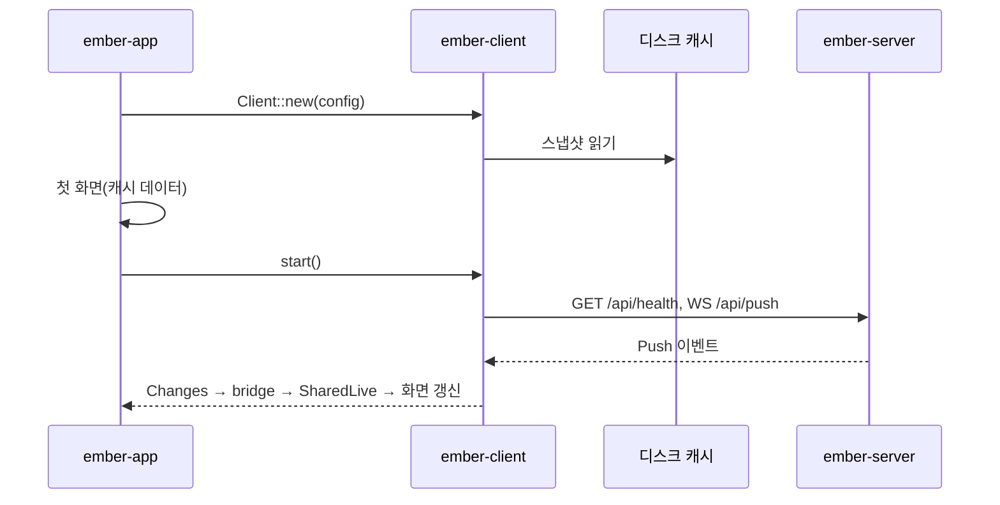
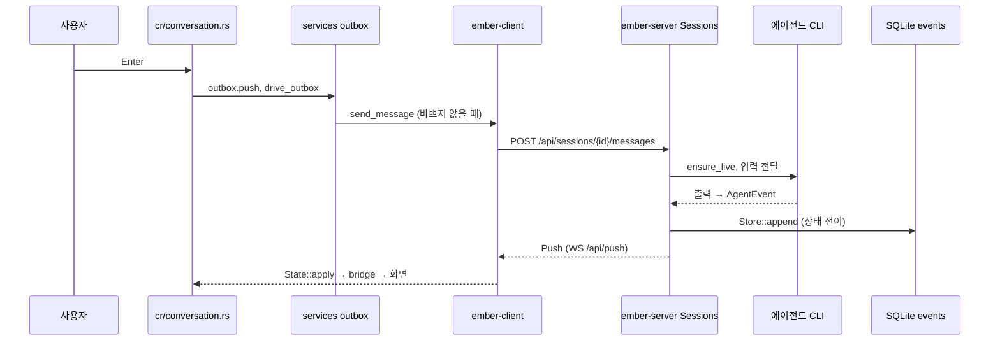
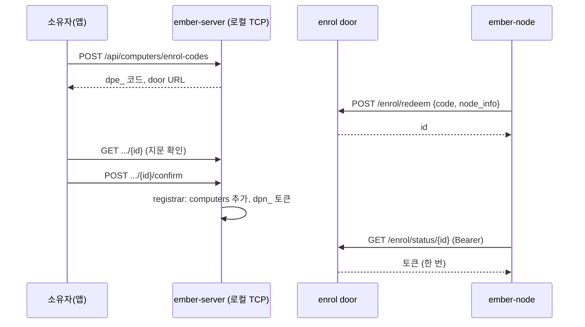

# 핵심 흐름

- 기준 커밋: `ffe9825` / 작성: 2026-11-13
- 근거는 각 단계의 `경로:줄`과 모듈 문서다. 경로는 저장소 루트 기준이고, `cr/`는 `ember/app/src/ui/cr/`를 줄인 것이다.

| 흐름 | 한 줄 |
|---|---|
| [1. 앱 시작과 첫 화면](#흐름-1-앱-시작과-첫-화면) | 캐시로 먼저 그리고, push 연결로 따라잡는다 |
| [2. 메시지 보내기와 에이전트 턴](#흐름-2-메시지-보내기와-에이전트-턴) | 앱 outbox → 서버 세션 → 에이전트 CLI → 이벤트 → push → 화면 |
| [3. 도구 승인과 중단](#흐름-3-도구-승인과-중단) | 승인 카드와 중단 버튼이 서버 세션 상태를 바꾸는 길 |
| [4. 세션을 다른 컴퓨터로 옮기기](#흐름-4-세션을-다른-컴퓨터로-옮기기) | 도구 실행 위치를 노드로 바꾼다. 대화는 서버에 남는다 |
| [5. 등록 코드로 컴퓨터 추가](#흐름-5-등록-코드로-컴퓨터-추가) | mint → redeem → 소유자 확인 → 토큰 전달 |
| [6. IDE 열기](#흐름-6-ide-열기) | 서버가 컴퓨터별 VS Code Web URL을 돌려주고 OS 브라우저로 연다 |

---

## 흐름 1. 앱 시작과 첫 화면

자세한 초기화 순서는 [_raw/entrypoints.md](_raw/entrypoints.md) "ember-app 초기화 순서".

1. `ember/app/src/lib.rs:48` `AppConfig::from_env`: `EMBER_SERVER_URL`, 데이터 폴더.
2. `ember/app/src/lib.rs:60` `Client::new`: 디스크 캐시의 스냅샷(프로젝트, 세션)을 먼저 읽는다 (FR-L1). 데이터 형태: 캐시 JSON → `State`.
3. `ember/app/src/lib.rs:90` `client.start()`: push WebSocket 루프 `push_loop` (`ember/client/src/client.rs:525`), 재동기화, 캐시 쓰기 워커를 띄운다. 데모 모드면 건너뛴다 (`lib.rs:73-86`).
4. `ember/app/src/lib.rs:105` `install(Services)`: 전역 `services()` ([modules/app-core.md](modules/app-core.md)).
5. `ember/app/src/lib.rs:143` `bridge::start_shared()`: `changes_task`(`ember/app/src/bridge.rs:128`)가 클라이언트 변경을 받아 `SharedLive`(`ember/app/src/ui/coexist.rs:39`)의 상태를 갱신하고, `refresh_task`(`bridge.rs:232`)가 서버 부가 정보를 주기적으로 읽는다.
6. `ember/app/src/lib.rs:145` `ui::cr::shell::launch` (`cr/shell.rs:779`): 창을 열고, 메뉴에 따라 화면을 고른다 ([01_FEATURE_MAP.md](01_FEATURE_MAP.md) "셸").

주의: push는 `ws://`만 지원한다. `https://` 서버 URL이면 HTTP 호출은 되지만 push가 실패한다 (`ember/client/src/api.rs:867-869`).

---

## 흐름 2. 메시지 보내기와 에이전트 턴

1. **입력:** 대화 입력창에서 Enter 또는 보내기. `send` 클로저가 `@@` 멘션을 치환하고 `outbox.push` → `bump_outbox` → `drive_outbox` (`cr/conversation.rs:316`, [modules/app-ui-cr-session.md](modules/app-ui-cr-session.md)).
2. **대기열:** `drive_outbox` (`ember/app/src/services.rs:99`)는 세션이 바쁘면 보내지 않고 쌓아 둔다. 화면에 "{n}개 대기 중". 턴 경계에서 `Outbox::next`가 다음 글을 풀어 준다 (FR-L6).
3. **HTTP:** `Client::send_message` (`ember/client/src/client.rs:255`) → `Api::send_message` (`ember/client/src/api.rs:929`) → `POST /api/sessions/{id}/messages`.
4. **서버 핸들러:** `send_message` (`ember/server/src/api/mod.rs:595`) → `Sessions::send` (`ember/server/src/session.rs:807`).
5. **프로세스 확보:** `ensure_live` (`session.rs:552`). 살아 있는 에이전트가 없으면 어댑터로 CLI를 띄운다. 전에 쓰던 네이티브 세션 id가 있으면 resume한다 (`session.rs:577`). 실행 훅: 환경 변수, 지시문, 프로젝트 마운트, MCP, egress 프록시 ([modules/server-core.md](modules/server-core.md) "에이전트 프로세스의 생애", [modules/server-agents.md](modules/server-agents.md)).
6. **이벤트:** 어댑터가 CLI 출력(JSON 줄 등)을 `AgentEvent`로 바꿔 채널로 보낸다. 이벤트 펌프(`session.rs:643-703`)가 `Sessions::record` (`session.rs:533`) → `Store::append` (`ember/server/src/store.rs:344-371`)로 `events` 테이블에 쓰고, 같은 트랜잭션에서 세션 상태를 바꾼다 (`UserMessage` → `running`, `TurnEnded` → `finished`/`failed`; `ember/server/src/events.rs:256-273`).
7. **push:** 서버가 `Push`를 `GET /api/push` WebSocket(`api/mod.rs:676`)으로 내보낸다. 클라이언트 `push_loop`가 받아 `State::apply` (`ember/client/src/state.rs:348`)로 반영하고, 앱 `changes_task`가 화면 상태로 옮긴다.
8. **실패:** 전송 실패 시 `Outbox::failed`, 배너 "전송하지 못했습니다: {오류}" 와 "다시 시도" (`cr/conversation.rs:801-813`).

데이터 형태: 입력 문자열 → `Outbox` 항목 → JSON `{text}` → `Sessions::send` → 에이전트 stdin/프로토콜 → `AgentEvent` → `events` 행(seq) → `Push` → `Transcript` → 대화 기록 행.

---

## 흐름 3. 도구 승인과 중단

- **승인:** 에이전트가 도구 실행 허락을 구하면 `ApprovalRequested` 이벤트로 세션이 `waiting_for_approval`이 된다 (`ember/server/src/events.rs:257-259`). 앱의 승인 카드("{tool} 실행을 허용할까요?", "한 번 허용", "항상 허용", "거부")가 `Client::answer` (`ember/client/src/client.rs:259`) → `POST /api/sessions/{id}/approvals/{approval_id}` (`ember/server/src/api/mod.rs:610`) → `Sessions::answer` (`ember/server/src/session.rs:845`)로 어댑터에 결정을 넘긴다. 결과 `ApprovalResolved`로 다시 `running`.
- **질문:** `QuestionAsked`/`QuestionAnswered`는 같은 길이고 `Sessions::answer_question` (`session.rs:865`)을 쓴다.
- **항상 허용:** `set_approve_all`이면 이벤트 펌프가 승인 요청을 자동으로 처리한다 (`session.rs:670-694`).
- **Antigravity:** 승인이 CLI 출력이 아니라 PreToolUse 훅의 HTTP 호출로 들어온다. 이 훅 라우트는 로컬 TCP 리스너에만 있다 (`ember/server/src/main.rs:485`, [modules/server-agents.md](modules/server-agents.md)).
- **중단:** 빨간 정지 버튼 → `Client::interrupt` (`ember/client/src/client.rs:304`) → `POST /api/sessions/{id}/interrupt` (`ember/server/src/api/mod.rs:657`) → `Sessions::interrupt` (`session.rs:1026`). 실패하면 토스트 "중단하지 못했습니다: {e}".
- **재시작 복원:** 서버가 다시 뜨면 저장된 대기 승인·질문을 어댑터에 복원한다 (`session.rs:628-635`).

---

## 흐름 4. 세션을 다른 컴퓨터로 옮기기

대화와 에이전트 프로세스는 항상 메인 서버에 있다 (README E3). 바뀌는 것은 "도구가 어디서 도는가"다.

1. 요청: `PUT /api/sessions/{id}/computer` → 핸들러 `switch` (`ember/server/src/computers/api.rs:41`) → `Computers::switch` (`ember/server/src/computers/mod.rs:1081`).
2. 기록: `session_computer` 테이블에 현재 컴퓨터를 쓴다 ([04_DATA_MODEL.md](04_DATA_MODEL.md)).
3. 효과: `Computers::install` (`computers/mod.rs:853`)이 걸어 둔 세션 훅 4개(instructions, prepare, start_config, message)가 다음 실행부터 도구를 그 컴퓨터로 보낸다.
   - Claude Code의 Bash 도구: `ember-exec` shim이 노드의 `/exec`로 ([modules/server-computers.md](modules/server-computers.md)).
   - Claude Code의 파일 도구: 프로젝트 폴더를 노드에서 NFS 또는 FUSE로 마운트 (`EMBER_MOUNT`).
   - Codex: app-server를 노드 `/exec-server`로 중계 (`computers/relay.rs`).
   - 에이전트 CLI의 API 트래픽: 세션별 CONNECT 프록시가 현재 컴퓨터로 (`ember/server/src/egress_proxy.rs`, FR-X6, `EMBER_AGENT_EGRESS=off`면 끔).
4. 노드 연결: HTTP(베어러 토큰) 또는 P2P transport ([modules/transport.md](modules/transport.md)). 노드 라우트는 [modules/node.md](modules/node.md).
5. 같은 길을 A2A의 `team spawn --computer`(`ember/server/src/main.rs:289-298`)와 스케줄러의 컴퓨터 지정(`main.rs:401-416`)도 쓴다.

주의: 앱의 세션 화면에서는 이 전환을 부르는 곳이 없다 ([01_FEATURE_MAP.md](01_FEATURE_MAP.md) "세션"). 대화 화면의 "컴퓨터" 줄은 `embedded = false`에서만 보인다.

---

## 흐름 5. 등록 코드로 컴퓨터 추가

상세: [modules/server-enrol.md](modules/server-enrol.md), 설계 `docs/design/COMPUTERS.md`.

상태: `waiting` → `awaiting_confirmation` → `confirmed` → `joined` (또는 `denied`, `expired`) (`ember/server/src/computers/enrol.rs:7-9`).

1. **mint (소유자, 로컬 TCP 전용):** `POST /api/computers/enrol-codes` → `mint` (`enrol.rs:1468`) → `Enrol::mint` (`enrol.rs:911`). `dpe_` 코드를 만들고 SHA-256만 `enrol_codes`에 저장. TTL 기본·상한 10분. enrol door가 꺼져 있으면 409 `door_off`.
2. **redeem (노드, enrol door):** `ember-node enrol <code> --server <url>` ([modules/node-enrol.md](modules/node-enrol.md)) → `POST /enrol/redeem` (별도 리스너 `EMBER_ENROL_LISTEN`) → `Enrol::redeem` (`enrol.rs:944`). 실패 한도기, 본문 4,096바이트 상한.
3. **소유자 확인:** 앱 또는 관리자가 노드가 보고한 정보와 지문을 보고 `POST .../{id}/confirm` (`enrol.rs:1527`, `Enrol::confirm` `enrol.rs:1213`) 또는 deny. 노드가 보낸 표시 값은 신뢰할 수 없으므로 평문으로만 그린다 (`enrol.rs:36-43`).
4. **등록:** `ComputersRegistrar` (`enrol.rs:656`)가 `computers` 테이블에 추가하고 노드용 토큰(`dpn_`)을 만든다.
5. **전달:** 노드가 `GET /enrol/status/{id}`로 폴링해 토큰을 한 번 받는다 (`Enrol::take_delivery`, `enrol.rs:1334`). 10분 안에 안 가져가면 `expired`, 컴퓨터도 제거.

---

## 흐름 6. IDE 열기

1. 앱 세션 화면의 "IDE 열기" 분할 버튼: `ide_main_click` (`cr/session.rs:470`) → `launch_ide_shared` (`cr/session.rs:171`).
2. `ServerApi::ide_targets` (`ember/app/src/server.rs:452`) → `GET /api/sessions/{id}/ide` → `ide_targets` (`ember/server/src/api/ide.rs:771`).
3. 서버는 세션의 현재 컴퓨터와 레지스트리에서 VS Code Web 주소를 고른다. 노드가 보고하지 않으면 `EMBER_IDE_COMPUTERS`, `EMBER_IDE_URL`, `EMBER_PUBLIC_URL`이 대신한다 (`ember/server/src/main.rs:45-46`, [modules/server-api.md](modules/server-api.md)).
4. 앱은 OS 기본 브라우저로 URL을 연다 (앱 안에는 웹뷰가 없다, NFR-L2).
5. 브라우저 쪽은 `ember/proxy/`가 VS Code Web을 감싸 오버레이와 로그인을 붙인다 ([modules/proxy.md](modules/proxy.md)).
6. 별도 네이티브 IDE 창(`ember-app --editor`)은 다른 길이다: `ember-editor`가 Code-OSS 서버에 직접 붙는다 ([modules/editor.md](modules/editor.md), [modules/editor-conn.md](modules/editor-conn.md)).

실패 문구: "세션이 없어 IDE를 열 수 없습니다" (`cr/project.rs:916-918`).
