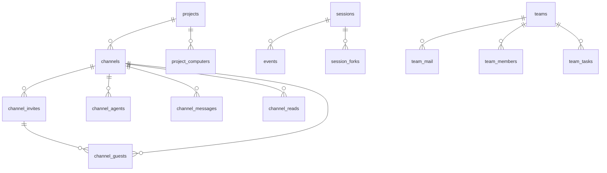

# 데이터 모델

- 기준 커밋: `ffe9825` / 작성: 2026-11-13
- 순서: 서버 DB, 파일에 저장하는 것, 주고받는 타입(DTO), 클라이언트 상태, 외부 연동.
- 환경 변수 전체 목록은 [02_GLOSSARY-2.md](02_GLOSSARY-2.md#환경-변수).

## 한눈에

| 저장 위치 | 무엇 | 누가 |
|---|---|---|
| `<EMBER_DATA_DIR>/ember.db` (기본 `~/.ember`) | 세션, 이벤트, 프로젝트, 컴퓨터, 계정, 채널, A2A, 일정 등 SQLite 39개 테이블 | ember-server |
| `<EMBER_DATA_DIR>/` 아래 파일 | 서버 토큰, 비밀 키, 계정 설정 폴더, shim, 채널 JSONL, 전송 파일 | ember-server |
| `<EMBER_NODE_STATE_DIR>/` (기본 `~/.ember/node`) | 노드 엔드포인트, 터미널 메타데이터, transport 키, 허용 peer, hub 등록, enrol 결과 | ember-node |
| `{data_dir}/` (앱, 기본 `dirs::data_dir()/ember`) | `prefs.json`, `client-cache.json`, `exports/` | ember-app |

## DB 테이블 (SQLite `<EMBER_DATA_DIR>/ember.db`)

서버 코드(테스트 제외)의 `CREATE TABLE` 39개를 그대로 뽑았다 (`.scratch/analysis/datamodel.py`). 모두 한 파일 `ember.db`에 있고, 테이블은 그것을 쓰는 하위 시스템 파일 안에서 만든다 (예: `computers/schema.rs`). 열 표기: PK 기본 키, NN NOT NULL, → 참조 테이블. 이후 `ALTER TABLE`로 더한 열은 빠졌을 수 있다 [확인 필요: 각 schema 파일의 마이그레이션].

| 테이블 | 정의 위치 | 열 |
|---|---|---|
| `a2a_tokens` | `ember/server/src/a2a/store.rs:18` | `session_id` TEXT (PK), `token_hash` TEXT (NN), `created_at` INTEGER (NN) |
| `a2a_messages` | `ember/server/src/a2a/store.rs:23` | `id` TEXT (PK), `from_session` TEXT (NN), `to_session` TEXT (NN), `reply_to` TEXT, `text` TEXT (NN), `created_at` INTEGER (NN), `delivered_at` INTEGER |
| `a2a_terminal_grants` | `ember/server/src/a2a/store.rs:34` | `reader` TEXT (NN), `target` TEXT (NN), `created_at` INTEGER (NN) |
| `a2a_switches` | `ember/server/src/a2a/store.rs:40` | `scope` TEXT (PK), `enabled` INTEGER (NN) |
| `a2a_messages (이전 판, 마이그레이션)` | `ember/server/src/a2a/store.rs:497` | `id` TEXT (PK), `from_session` TEXT (NN), `to_session` TEXT (NN), `reply_to` TEXT, `text` TEXT (NN), `created_at` INTEGER (NN), `delivered_at` INTEGER |
| `teams` | `ember/server/src/a2a/team.rs:42` | `id` TEXT (PK), `leader_session` TEXT (NN), `project` TEXT (NN), `created_at` INTEGER (NN) |
| `team_members` | `ember/server/src/a2a/team.rs:48` | `session_id` TEXT (PK), `team_id` TEXT (NN,→teams), `name` TEXT (NN), `role` TEXT (NN), `joined_at` INTEGER (NN), `ended_at` INTEGER |
| `team_tasks` | `ember/server/src/a2a/team.rs:58` | `id` TEXT (PK), `team_id` TEXT (NN,→teams), `number` INTEGER (NN), `title` TEXT (NN), `detail` TEXT (NN), `status` TEXT (NN), `assignee` TEXT, `created_by` TEXT (NN), `created_at` INTEGER (NN), `updated_at` INTEGER (NN) |
| `team_mail` | `ember/server/src/a2a/team.rs:71` | `id` INTEGER (PK), `team_id` TEXT (NN,→teams), `from_session` TEXT (NN), `to_session` TEXT, `text` TEXT (NN), `created_at` INTEGER (NN) |
| `accounts` | `ember/server/src/accounts/schema.rs:5` | `id` TEXT (PK), `agent` TEXT (NN), `label` TEXT (NN), `config_dir` TEXT (NN), `status` TEXT (NN), `is_default` INTEGER (NN), `limited_until` INTEGER, `limit_reason` TEXT, `created_at` INTEGER (NN) |
| `api_providers` | `ember/server/src/accounts/schema.rs:31` | `id` TEXT (PK), `label` TEXT (NN), `kind` TEXT (NN), `base_url` TEXT, `key_nonce` BLOB (NN), `key_ciphertext` BLOB (NN), `created_at` INTEGER (NN) |
| `browser_egress` | `ember/server/src/browser/egress.rs:65` | `project` TEXT (PK), `kind` TEXT (NN), `value` TEXT (NN), `updated_at` INTEGER (NN) |
| `channel_invites` | `ember/server/src/channels/invites.rs:17` | `id` TEXT (PK), `channel_id` TEXT (NN,→channels), `token_hash` TEXT (NN), `created_by` TEXT (NN), `created_at` INTEGER (NN), `expires_at` INTEGER (NN), `used_at` INTEGER, `revoked_at` INTEGER |
| `channel_guests` | `ember/server/src/channels/invites.rs:28` | `id` TEXT (PK), `channel_id` TEXT (NN,→channels), `invite_id` TEXT (NN,→channel_invites), `name` TEXT (NN), `credential_hash` TEXT (NN), `created_at` INTEGER (NN), `expires_at` INTEGER (NN), `revoked_at` INTEGER, `allow_until` INTEGER |
| `channels` | `ember/server/src/channels/mod.rs:30` | `id` TEXT (PK), `project` TEXT (NN,→projects), `name` TEXT (NN), `is_default` INTEGER (NN), `created_at` INTEGER (NN) |
| `channel_agents` | `ember/server/src/channels/mod.rs:38` | `channel_id` TEXT (NN,→channels), `session_id` TEXT (NN) |
| `channel_messages` | `ember/server/src/channels/mod.rs:43` | `seq` INTEGER (PK), `channel_id` TEXT (NN,→channels), `author` TEXT (NN), `body` TEXT (NN), `at` INTEGER (NN) |
| `channel_reads` | `ember/server/src/channels/mod.rs:56` | `channel_id` TEXT (NN,→channels), `reader` TEXT (NN), `last_seq` INTEGER (NN) |
| `chatgpt_accounts` | `ember/server/src/chatgpt/schema.rs:7` | `id` TEXT (PK), `label` TEXT (NN), `client_id` TEXT (NN), `subject` TEXT (NN), `email` TEXT, `scopes` TEXT (NN), `plan_usage` INTEGER (NN), `status` TEXT (NN), `access_expires_at` INTEGER, `refresh_expires_at` INTEGER, `earliest_refresh_at` INTEGER, `token_nonce` BLOB, `token_ciphertext` BLOB, `limited_until` INTEGER, `limit_reason` TEXT, `created_at` INTEGER (NN), `updated_at` INTEGER (NN) |
| `chatgpt_host` | `ember/server/src/chatgpt/schema.rs:36` | `id` INTEGER (PK), `host_id` TEXT (NN) |
| `chatgpt_usage` | `ember/server/src/chatgpt/schema.rs:42` | `account_id` TEXT (NN), `day` TEXT (NN), `input_tokens` INTEGER (NN), `output_tokens` INTEGER (NN), `reports` INTEGER (NN) |
| `enrol_codes` | `ember/server/src/computers/enrol.rs:90` | `id` TEXT (PK), `code_hash` BLOB (NN), `name` TEXT (NN), `created_ms` INTEGER (NN), `expires_ms` INTEGER (NN), `used_ms` INTEGER, `computer_id` TEXT |
| `computers` | `ember/server/src/computers/schema.rs:9` | `id` TEXT (PK), `name` TEXT (NN), `url` TEXT (NN), `token` TEXT (NN), `created_at` INTEGER (NN) |
| `session_computer` | `ember/server/src/computers/schema.rs:19` | `session_id` TEXT (PK), `computer_id` TEXT (NN), `env_json` TEXT, `notice` TEXT, `switched_at` INTEGER (NN) |
| `session_designated` | `ember/server/src/computers/schema.rs:55` | `session_id` TEXT (PK), `computer_id` TEXT (NN) |
| `devices` | `ember/server/src/devices/schema.rs:7` | `peer_id` TEXT (PK), `name` TEXT (NN), `created_at` INTEGER (NN) |
| `session_forks` | `ember/server/src/fork.rs:19` | `session_id` TEXT (PK,→sessions), `parent_id` TEXT (NN), `parent_seq` INTEGER (NN), `forked_at` INTEGER (NN), `seeded` INTEGER (NN) |
| `hub_registration` | `ember/server/src/hub/schema.rs:7` | `id` INTEGER (PK), `hub_url` TEXT (NN), `endpoint_id` TEXT (NN), `device_json` TEXT (NN), `token_nonce` BLOB (NN), `token_ciphertext` BLOB (NN), `registered_at` INTEGER (NN), `revoked_at` INTEGER |
| `hub_pending_link` | `ember/server/src/hub/schema.rs:30` | `id` INTEGER (PK), `hub_url` TEXT (NN), `link_id` TEXT (NN), `expires_at` INTEGER (NN) |
| `mcp_servers` | `ember/server/src/mcp/schema.rs:11` | `id` TEXT (PK), `name` TEXT (NN), `command` TEXT (NN), `args` TEXT (NN), `env_keys` TEXT (NN), `env_nonce` BLOB, `env_ciphertext` BLOB, `enabled` INTEGER (NN), `scope` TEXT (NN), `created_at` INTEGER (NN), `updated_at` INTEGER (NN) |
| `session_proxy` | `ember/server/src/members.rs:25` | `session_id` TEXT (PK), `endpoint` TEXT (NN), `key_env` TEXT |
| `projects` | `ember/server/src/projects/schema.rs:12` | `name` TEXT (PK), `created_at` INTEGER (NN) |
| `project_computers` | `ember/server/src/projects/schema.rs:19` | `project` TEXT (NN,→projects), `computer_id` TEXT (NN), `assigned_at` INTEGER (NN) |
| `schedules` | `ember/server/src/schedules/schema.rs:14` | `id` TEXT (PK), `project` TEXT (NN), `agent` TEXT (NN), `account_id` TEXT, `computer_id` TEXT, `cwd` TEXT, `prompt` TEXT (NN), `kind` TEXT (NN), `target` TEXT (NN), `paused` INTEGER (NN), `catch_up` INTEGER (NN), `anchor_at` INTEGER (NN), `next_run_at` INTEGER, `last_run_at` INTEGER, `created_by_session` TEXT, `created_at` INTEGER (NN), `updated_at` INTEGER (NN) |
| `schedule_runs` | `ember/server/src/schedules/schema.rs:36` | `id` TEXT (PK), `schedule_id` TEXT (NN), `scheduled_at` INTEGER (NN), `status` TEXT (NN), `session_id` TEXT, `started_at` INTEGER, `finished_at` INTEGER, `error` TEXT |
| `sessions` | `ember/server/src/store.rs:88` | `id` TEXT (PK), `project` TEXT (NN), `agent` TEXT (NN), `cwd` TEXT (NN), `model` TEXT, `native_id` TEXT, `status` TEXT (NN), `title` TEXT (NN), `created_at` INTEGER (NN), `updated_at` INTEGER (NN), `last_seq` INTEGER (NN) |
| `events` | `ember/server/src/store.rs:101` | `session_id` TEXT (NN,→sessions), `seq` INTEGER (NN), `at` INTEGER (NN), `event` TEXT (NN) |
| `shim_offsets` | `ember/server/src/store.rs:113` | `session_id` TEXT (PK), `offset` INTEGER (NN) |
| `harness_settings` | `ember/server/src/store.rs:122` | `harness` TEXT (NN), `key` TEXT (NN), `value` TEXT (NN), `updated_ms` INTEGER (NN) |

### 관계 (외래 키와 이름으로 추정한 연결)

`erDiagram`에는 SQL에 `REFERENCES`로 적힌 관계만 넣었다. `session_*` 테이블과 `sessions`, `schedule_runs`와 `schedules`처럼 이름으로 이어지는 관계는 코드에서 `session_id`/`schedule_id` 열로 묶이지만 외래 키가 없을 수 있다.

## 파일에 저장하는 것

| 경로 | 내용 | 정의·근거 | 주의 |
|---|---|---|---|
| `<data dir>/server-token` | owner 리스너의 베어러 토큰 (FR-S9) | `ember/server/src/auth.rs`, 출력 `ember/server/src/main.rs:502-506` | 앱과 CLI가 이 파일을 읽어 인증한다 ([modules/client.md](modules/client.md) `token.rs`) |
| `<data dir>/secret.key` | 계정 자격 증명 암호화 키 (chacha20poly1305) | `ember/server/src/accounts/secrets.rs` | Windows에서는 권한 검사가 없다 ([05_ISSUES.md](05_ISSUES.md)의 심각도 높음 보안 이슈) |
| `<data dir>/accounts/` | 에이전트 CLI별 계정 설정 폴더 (`accounts.config_dir`) | `ember/server/src/accounts/mod.rs` | [modules/server-accounts.md](modules/server-accounts.md) |
| `<data dir>/shims/` (`<id>.spec.json`, `<id>.sock`, `<id>.log`) | 세션 shim 실행 사양, 소켓, 로그 (FR-S8) | `ember/server/src/main.rs:99-101`, `ember/server/src/session_shim.rs` | 서버를 꺼도 shim은 남는다 |
| `<data dir>/agy/conversations/<id>` | Antigravity 세션별 설정 폴더 | [modules/server-agents.md](modules/server-agents.md) | |
| `<data dir>/channels/<id>.jsonl` | 채널 메시지 JSONL 사본 (FR-T16) | `ember/server/src/channels/jsonl.rs`, 시작 시 복구 `main.rs:119` | DB와 어긋나면 시작할 때 고친다 |
| `<data dir>/transport.key` | 서버 P2P 키 (`EMBER_TRANSPORT=1`) | `ember/server/src/transport.rs` | peer id가 이 키에서 나온다 |
| `<data dir>/received/`, `transfers-history.json`, `.partial/` | 받은 파일, 전송 기록, 받는 중인 조각 | `ember/server/src/transfers.rs`, [modules/transfer.md](modules/transfer.md) | |
| `<state>/local.json` | 노드 주소와 토큰 (ember-term, VS Code 동반 확장이 읽는다) | `ember/node/src/main.rs:101` | 토큰이 들어 있다 |
| `<state>/terms/<id>.json`, `<id>.snap` | 터미널 메타데이터와 화면 스냅샷 | [modules/node-term.md](modules/node-term.md) | |
| `<state>/transport.key`, `<state>/allowed-peers` | 노드 P2P 키, 허용할 서버 peer id 목록 (SIGHUP으로 다시 읽음) | [modules/node.md](modules/node.md) | |
| `<state>/hub.json`, `hub-link.json` | darkpyonix.dev 등록 정보(기기 토큰 포함) | [modules/hub.md](modules/hub.md) | 0600은 unix에서만 |
| `<state>/enrol.json` | `ember-node enrol` 결과 | [modules/node-enrol.md](modules/node-enrol.md) | |
| `{data_dir}/prefs.json` | 앱 설정 (테마, 키맵, IDE 대상 등) | `ember/app/src/prefs.rs`, 위치 `ember/app/src/config.rs:33-52` | 깨지면 기본값으로 시작 |
| `{data_dir}/client-cache.json` | 콜드 스타트 캐시 (첫 화면용 스냅샷) | `ember/client/src/cache.rs`, `ember/app/src/config.rs` | 데모 데이터는 쓰지 않는다 (`ember/app/src/lib.rs:158-163`) |

## 주고받는 타입 (DTO)

| 경계 | 타입 정의 | 설명 |
|---|---|---|
| 앱 ↔ 서버 HTTP·push | `ember/client/src/wire.rs` (팬인 28) | `SessionRecord`, `AgentEvent`, `Push`, `Project`, `TeamView`, `Schedule` 등. 서버 쪽 원본은 `ember/server/src/events.rs`(`AgentEvent`, `SessionStatus`)와 각 api 파일. 두 쪽을 함께 바꿔야 한다 |
| 클라이언트 메서드 ↔ 라우트 | [modules/client.md](modules/client.md) "`Api` 메서드 → HTTP 라우트 표" | `Api::send`가 경로 앞에 `/api`를 붙인다 (`ember/client/src/api.rs:781`) |
| 서버 ↔ 노드 | `ember/node/src/proto.rs` (팬인 25) | 파일, git, 터미널, exec, jobs 요청·응답. 서버 쪽 클라이언트는 `ember/node/src/client.rs` |
| 서버 ↔ 에이전트 CLI | 어댑터마다 다름 | Claude Code·Codex·Antigravity는 각 CLI의 JSON 출력, ACP는 Agent Client Protocol ([modules/server-agents.md](modules/server-agents.md)) |
| 에디터 ↔ Code-OSS 서버 | `ember/editor-conn/src/protocol.rs`, `rpc_ids.rs` | VS Code 원격 프로토콜. `rpc_ids.rs`는 `ember/ose/VERSION`에 고정 ([modules/editor-conn.md](modules/editor-conn.md)) |
| IDE 창 웹뷰 ↔ 네이티브 | `ember/bridge/src/messages.rs` | 버전 붙은 메시지. 지금은 이 크레이트를 쓰는 곳이 없다 |

## 클라이언트 상태

- `ember_client::State` (`ember/client/src/state.rs`): 서버 스냅샷과 push를 `apply`(`state.rs:348`)로 합친 순수 리듀서. 대화 기록은 `Transcript` (`ember/client/src/transcript.rs`).
- 앱 전역 `Services` (`ember/app/src/services.rs`): 런타임, `Client`, `ServerApi`, 데모 소스, `outbox`, 초기 설정, `SharedUi` ([modules/app-core.md](modules/app-core.md)).
- 화면 상태 `SharedLive` (`ember/app/src/ui/coexist.rs:39`): 기본 실행 경로가 읽는 실제 신호. 필드는 `launcher`, `transcripts`, `outbox`, `teams`, `accounts`, `chatgpt`, `agents` 등.
- `Outbox` (`ember/app/src/model.rs:454`): 세션별 보내기 대기열 (FR-L6).
- 옛 Dioxus 경로의 `Live`, `use_bridge`(`ember/app/src/bridge.rs:42`, `:104`)는 기본 경로에서 쓰이지 않는다.

## 외부 연동

| 대상 | 어디서 부르나 | 환경 변수 | 실패 처리 |
|---|---|---|---|
| Claude Code CLI (`claude`) | `ember/server/src/agents/claude_code.rs` | `EMBER_CLAUDE_BIN` | 없으면 "설치 안 됨"으로 보고 (FR-A6) |
| Codex CLI (`codex`) | `ember/server/src/agents/codex.rs`, 노드 `/exec-server` | `EMBER_CODEX_BIN`, `EMBER_NODE_CODEX_BIN` | 같음 |
| Antigravity CLI (`agy`) | `ember/server/src/agents/antigravity.rs` | `EMBER_AGY_BIN`, `EMBER_AGY_SANDBOX` | 검증 안 된 버전은 읽기 전용 (INTENT D14) |
| ACP 에이전트 (`omp`, `gemini` 등) | `ember/server/src/agents/acp.rs` | `EMBER_ACP_AGENTS`, `EMBER_ACP_AGENTS_FILE`, `EMBER_OMP_BIN`, `EMBER_GEMINI_BIN` | 설정이 잘못되면 시작 오류 (`main.rs:133-136`) |
| `git`, `gh` | 노드 `ember/node/src/git*.rs` | - | `gh`가 없으면 409 ([modules/node-git.md](modules/node-git.md)) |
| Chrome/Chromium (CDP) | `ember/server/src/browser/` | `EMBER_CHROME_BIN`, `EMBER_BROWSER_MCP`, `EMBER_BROWSER_MCP_RUNNER` | 없으면 원격 브라우저 끔 (`main.rs:325-328`) |
| 브라우저 MCP (`npx`/`bunx`로 chrome-devtools 또는 playwright) | `ember/server/src/browser/agent.rs` | `EMBER_BROWSER_MCP` | 기본 off |
| darkpyonix.dev hub | `ember/hub/`, `ember/server/src/hub/`, `ember/node/src/hub.rs` | `EMBER_HUB_URL`, `EMBER_HUB_RELAY_URL`, `EMBER_HUB_SYNC_DEVICES` | 미등록이면 연락하지 않는다 (`main.rs:163-169`) |
| letify relay (P2P) | `ember/transport/src/letify/` | `EMBER_RELAY_URL`, `EMBER_SERVER_RELAY*`, `EMBER_LETIFY_*` | [modules/transport.md](modules/transport.md) |
| OpenAI (Sign in with ChatGPT, OAuth) | `ember/server/src/chatgpt/` | `EMBER_HOSTED`, `EMBER_CHATGPT_REDIRECT_PORT` | 호스티드면 끔. ID 토큰 서명(JWKS)은 검증하지 않는다 ([05_ISSUES.md](05_ISSUES.md)) |
| Code-OSS (VS Code) 서버 | `ember/editor-conn/`, `ember/proxy/`, `ember/ose/` | `EMBER_IDE_*`, proxy의 `XMO_*` | [modules/proxy.md](modules/proxy.md) |
| OS 파일 시스템 마운트 (NFS, FUSE) | `ember/server/src/computers/mount/` | `EMBER_MOUNT`, `EMBER_MOUNT_SHADOW`, `EMBER_MOUNT_TTL_MS` | 실패하면 마운트만 끄고 계속 (`main.rs:223-229`) |
| DarkPyonix notebook manager | `extensions/vscode-darkpyonix/`, `extensions/intellij-darkpyonix/` | 확장 설정 | API는 `darkpyonix-core` 저장소 소관 ([modules/extensions.md](modules/extensions.md)) |
